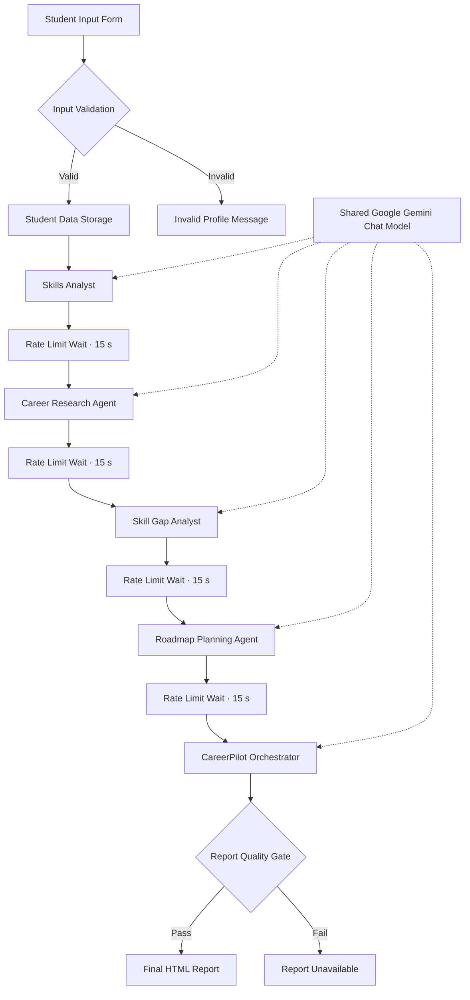

<h1 align="center">CareerPilot</h1>

<strong>No-Code Multi-Agent AI Career Advisor</strong>

Turn a student profile and a target career into a skill-gap analysis and a personalized 30/60/90-day learning roadmap.

  
  
  
  

[Overview](#overview) · [Features](#key-features) · [Architecture](#multi-agent-architecture) · [Example](#example-use-case) · [Setup](#installation-and-setup) · [Validation](#testing-and-validation) · [Demonstration](#project-demonstration)

## Overview

Students often know which role they want but struggle to translate broad role requirements into a plan that fits their current skills and weekly availability. Skill-gap analysis helps them prioritize what to learn and decide what evidence to build through practice and portfolio projects.

CareerPilot is a university Agentic AI project built visually in n8n with ChatGPT and Model Context Protocol (MCP) assistance. Four specialist agents produce intermediate analyses, and a fifth agent reviews and consolidates them into a browser-readable report. n8n defines a deterministic, sequential execution order. The agents' generated text can vary between runs.

## Key features

| Feature | What CareerPilot does |
| --- | --- |
| Student profile collection | Collects education, skills, experience, target role, and available study time through an n8n form. It validates and stores accepted submissions in an n8n Data Table. |
| Skills assessment | Distinguishes self-reported skills, evidence from described projects, and unverified capabilities. |
| Career requirements and skill gaps | Uses general role knowledge to identify typical competencies and prioritize gaps in the student's evidence. |
| Personalized roadmap | Plans learning, practice, and project work across 30-, 60-, and 90-day phases using the student's weekly time budget. |
| Portfolio project recommendations | Suggests projects and milestones that give the student a way to demonstrate priority skills. |
| Career readiness assessment | Provides a subjective estimate based on the available profile and typical role expectations. |
| HTML report and error handling | Renders the report in the browser after a content check. Invalid profiles, agent errors, and failed report checks have dedicated response branches. |
| API rate-limit pacing | Inserts four 15-second waits between agent stages within each run. |

## Multi-agent architecture

The [workflow export](workflows/CareerPilot_Workflow.json) contains 17 native n8n nodes. The solid arrows show execution order and the dotted arrows show the shared Gemini model dependency.

Each agent can also route an execution error to the **Report Unavailable** response. n8n expressions reference the original form submission and the outputs of named upstream nodes to build each agent's prompt.

| Agent | Responsibility and context |
| --- | --- |
| Skills Analyst | Reviews the submitted profile and summarizes reported skills, project evidence, and uncertainties. |
| Career Research Agent | Uses the target role, experience level, and skills assessment to outline typical entry-level competencies. |
| Skill Gap Analyst | Compares the submitted skills and projects with the two upstream analyses. Prioritizes gaps and estimates readiness. |
| Roadmap Planning Agent | Uses the prioritized gaps, profile, goals, and weekly time budget to plan 12 weeks of learning and portfolio work. |
| CareerPilot Orchestrator | Reads all four specialist outputs and selected form fields, reviews consistency and time allocations, and generates the final HTML fragment. |

## Technology stack

| Component | Role |
| --- | --- |
| n8n | Runs the visual workflow and defines the execution sequence, branching, and data flow. |
| Google Gemini | Supplies the shared language model. Gemini 3 Flash Preview is the project model. The exported node leaves the model selection implicit, so verify it after import. |
| Model Context Protocol (MCP) | Supported workflow creation and management through ChatGPT. The connected n8n nodes execute the agent pipeline. |
| n8n Forms | Hosts the student input form and renders the final report or an error response. |
| n8n Data Tables | Persist validated student submissions inside the n8n project. |
| Native AI Agent nodes | Define each stage's instructions and use the shared Gemini Chat Model node. |
| Native Wait nodes | Pause between agent stages to space out model requests. |

## How CareerPilot works

1. The student submits their name, education, existing skills, target role, experience level, and weekly learning hours. Projects and career goals are optional.
2. The form enforces required fields. The workflow also checks that the name, education, skills, and target role are nonblank and that weekly learning hours are greater than zero. Invalid input receives an explanatory response.
3. The workflow inserts the accepted profile into the configured Data Table before starting the skills analysis.
4. The four specialists run in order. A 15-second wait follows each specialist, including the roadmap planner. The final orchestrator then reviews the specialist outputs and writes the HTML report.
5. The quality gate checks for an HTML heading marker, the readiness section, all three roadmap headings, and next steps. A passing report renders in the browser. Agent errors and failed report checks return a report-unavailable response. The gate checks content markers and leaves detailed assessment of the report to the reader.

## Example use case

| Field | Fictional student profile |
| --- | --- |
| Full name | Alex Student |
| Education | BS Software Engineering |
| Skills | HTML, CSS, JavaScript, React, Git |
| Projects | Portfolio website and task management application |
| Target role | Full Stack Developer |
| Experience level | Beginner |
| Weekly learning hours | 10 |

The reported skills support a frontend starting point. Since the project descriptions leave server-side work unverified, the analysis prioritizes backend development, databases, API design, and authentication. A portfolio milestone could extend the task management application with a persistent database, a documented API, and authenticated access.

| Phase | Example focus | Time |
| --- | --- | --- |
| Days 1–30 | Learn backend fundamentals and build initial API endpoints. | 40 hours |
| Days 31–60 | Connect a database, refine API design, and add authentication. | 40 hours |
| Days 61–90 | Integrate the frontend, test the full-stack application, and document it for a portfolio. | 40 hours |

The example allocates **120 hours across 12 weeks**, with 10 hours per week covering both learning and project work.

## Installation and setup

1. **Run n8n.** Use n8n Cloud or self-host a version that supports Data Tables and the node versions in the export. For local hosting, follow the [n8n Docker Compose installation guide](https://docs.n8n.io/deploy/host-n8n/install-options/install-using-docker-compose.md).
2. **Import the workflow.** In the n8n editor, open the workflow menu and choose **Import from File**. Select [CareerPilot_Workflow.json](workflows/CareerPilot_Workflow.json). The export supplies workflow definitions and instance-specific references. Provision your own credentials and Data Table. [n8n import documentation](https://docs.n8n.io/workflows/export-import/)
3. **Configure Gemini.** Create a Google Gemini (PaLM) credential in n8n using your own Gemini API key, then select it in **CareerPilot Gemini**. Explicitly select Gemini 3 Flash Preview (`gemini-3-flash-preview`) if it is available to your project. If you choose another available model, validate its output separately. [n8n Gemini credential documentation](https://docs.n8n.io/integrations/builtin/credentials/googleai/) · [Google model documentation](https://ai.google.dev/gemini-api/docs/models/gemini-3-flash-preview)
4. **Configure student storage.** Create a Data Table in the workflow's project, for example `careerpilot_submissions`. Add text columns `full_name`, `education`, `skills`, `projects`, `target_role`, `experience_level`, and `career_goal`, plus a number column `weekly_hours`. Open **Save Student Submission**, select the new table, and verify the field mappings and insert operation. [n8n Data Tables documentation](https://docs.n8n.io/data/data-tables/)
5. **Verify and test the form.** Open **CareerPilot Student Form**, check its required fields and Test URL, and choose **Execute Workflow**. Submit the fictional Alex Student profile and confirm it creates a row, executes all five agents, passes the report quality gate, and displays the report. Verify the weekly time budget in the output. Use zero weekly hours to check that invalid submissions reach the validation response. [n8n Form Trigger documentation](https://docs.n8n.io/integrations/builtin/core-nodes/n8n-nodes-base.formtrigger/)
6. **Activate when ready.** Save and publish the workflow, or use the activation control in your n8n version. Use the Form Trigger's **Production URL** and keep your n8n instance running. The export enables saving execution data, and the workflow stores submissions and sends profile context to Gemini. Review form access and data retention before accepting real student submissions.

## Testing and validation

| Historical manual check | Observed result |
| --- | --- |
| Specialist execution | All four specialist agents completed. |
| Final report generation | The orchestrator completed and the report passed the quality gate. |
| Gemini pacing | The workflow completed a full run with all four waits. |
| Browser output | The HTML report displayed successfully. |
| End-to-end duration | Approximately 3 minutes 45 seconds for the example run. |
| Roadmap allocation | 10 hours per week for 12 weeks, totaling 120 hours. |

Repository finalization checked the JSON syntax, node count, agent connections, wait settings, response paths, and README file references. The observations above come from the project's historical manual run. Performance and quota behavior can vary with the instance, model, and concurrent usage.

## Limitations

- Gemini API quotas apply. Fixed waits pace requests within a single run and offer no guarantee of quota compliance across runs.
- n8n runs the agents in a fixed sequence with a shared model. Each stage depends on the preceding stages.
- Career requirements come from general model knowledge. The project has no verified live job-market integration.
- Recommendations are advisory. The readiness estimate is a subjective heuristic and should never be interpreted as an employment probability.
- A locally hosted instance must stay running and reachable for the form to work. An ngrok URL can change or become unavailable when the tunnel stops.

## Future improvements

- Resume PDF upload and parsing.
- Verified job-market research with cited sources.
- Downloadable PDF reports.
- Additional career pathways.
- More options for customizing the report.
- Optional user history and progress tracking.

## Project demonstration

1. Open the n8n canvas and trace the 17-node workflow. Point out the shared Gemini node, four specialists, final orchestrator, and waits.
2. Submit the fictional Alex Student profile through the test form. Show the Data Table row and follow the execution through the specialist stages.
3. Open the browser report. Identify a backend skill gap, trace it to a roadmap activity and portfolio recommendation, and check the 10-hour weekly budget and 120-hour total.
4. Submit the same fictional profile with zero weekly hours to demonstrate the validation response. Allow time for the successful run, which historically took about 3 minutes 45 seconds.

## License and author

CareerPilot is available under the [MIT License](LICENSE).

**Author** — Syeda Mahnoor
